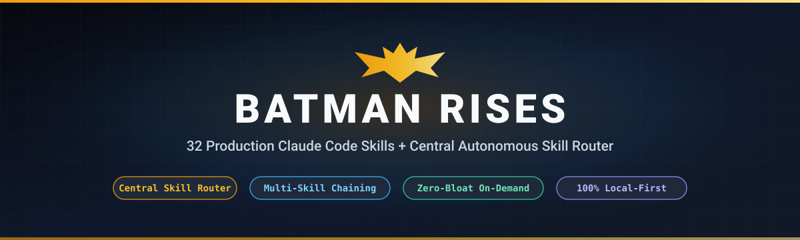
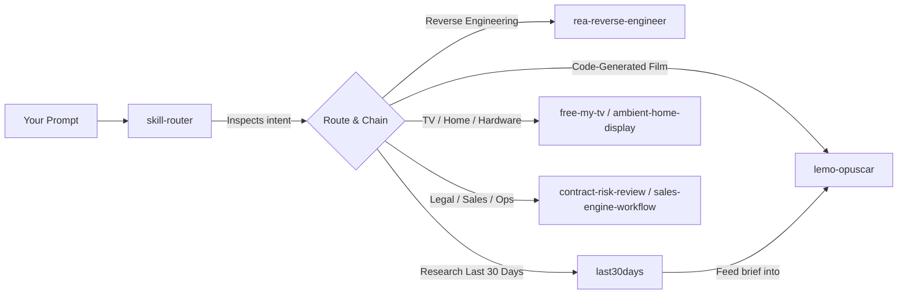

# Batman Rises

**29 modular Claude Code skills, a Central Skill Router, and a Master skill that picks and chains them, with tested local scripts.**

Start with [`batman-master`](./batman-master/SKILL.md) for multi-skill workflows. Verify the library with `python3 tests/test_skills.py`.

- [Quick Install](#quick-install)
- [Multi-Skill Chains to Try](#multi-skill-chains-to-try)
- [Full Skill Catalog (29 Skills)](#full-skill-catalog-29-skills)
- [Contributing](./CONTRIBUTING.md) · [MIT License](./LICENSE)

## Why Batman Rises?

Most AI skill packs dump everything into your context window or leave you hunting for the right slash command. **Batman Rises** pairs **29 specialized, real-world skills** with a **Central Skill Router (`skill-router`)** that:

1. **Discovers** every skill in your directory dynamically (including new ones you add later).
2. **Routes** your prompt to the exact skill needed without loading all 29 files into context.
3. **Chains** multiple skills together end-to-end (for example, 30-day social research into a code-generated short film, or podcast clipping into a multi-channel content pipeline).

## How the Central Router Works



## Quick Install

Clone the repository and run the installer to symlink all skills into `~/.claude/skills/batman-rises`:

```bash
git clone https://github.com/kammakrishnakiran123-stack/batman-rises.git
cd batman-rises
bash install.sh
```

## Multi-Skill Chains to Try

Copy and paste these directly into Claude Code once installed:

- **Research to Film Studio**: *"Use `last30days` to research what developers are saying about local AI agents this month, then use `lemo-opuscar` to turn it into a 45-second Swiss Motion Graphics explainer film."*
- **Podcast to Viral Content Engine**: *"Use `podcast-clipper-search` to transcribe `episode.mp4`, pull the 3 sharpest clips with captions, and run `content-production-pipeline` to write X threads and a newsletter."*
- **Meeting to Proposal & Risk Check**: *"Run `meeting-to-proposal` on these call notes to draft an SOW, then review it with `contract-risk-review` for missing liability caps and IP traps."*
- **Binary to Clean-Room Feature**: *"Inspect `app.asar` with `rea-reverse-engineer` to trace how offline search works, and explain the exact control flow with evidence."*
- **Old Tablet to Smart Wall Display**: *"Use `ambient-home-display` to build a zero-scroll dark-mode kiosk dashboard with clock, weather, and auto night dimming."*

## Full Skill Catalog (29 Skills)

### 1. Engineering, Reverse Engineering & Web Extraction

| Skill | What It Does | Reference / Tooling |
| --- | --- | --- |
| [`context7-live-docs`](./context7-live-docs/SKILL.md) | Fetch live, version-specific library & API docs via `ctx7` CLI or Context7 MCP | [`upstash/context7`](https://github.com/upstash/context7) |
| [`playwright-browser-automation`](./playwright-browser-automation/SKILL.md) | Token-efficient browser automation, E2E UI testing, screenshots, and network/console inspection | [`microsoft/playwright-cli`](https://github.com/microsoft/playwright-cli) |
| [`planning-with-files`](./planning-with-files/SKILL.md) | Crash-proof, Manus-style persistent file-based planning (`task_plan.md`, `findings.md`, `progress.md`) | [`OthmanAdi/planning-with-files`](https://github.com/OthmanAdi/planning-with-files) |
| [`security-audit-static`](./security-audit-static/SKILL.md) | Static security audits, Semgrep/CodeQL, variant analysis, supply-chain & GitHub Actions checks | [`trailofbits/skills`](https://github.com/trailofbits/skills) |
| [`caveman-token-saver`](./caveman-token-saver/SKILL.md) | Cut Claude Code token usage with ultra-terse replies, log compression, and `CLAUDE.md` shrinking | [`JuliusBrussee/caveman`](https://github.com/JuliusBrussee/caveman) |
| [`superpowers-dev-workflow`](./superpowers-dev-workflow/SKILL.md) | Spec-first planning, git worktrees, RED-GREEN-REFACTOR TDD, subagent dev, and systematic debugging | [`obra/superpowers`](https://github.com/obra/superpowers) |
| [`rea-reverse-engineer`](./rea-reverse-engineer/SKILL.md) | Reverse engineer native binaries, Electron/ASAR bundles, APKs, `.NET`, and HAR/SAZ captures | [`morluto/rea`](https://github.com/morluto/rea) |
| [`crawl4ai-website-reader`](./crawl4ai-website-reader/SKILL.md) | Scrape JS-rendered webpages and SPAs locally into clean Markdown or JSON | Crawl4AI (`crwl`) |
| [`deepcrawl-website-reader`](./deepcrawl-website-reader/SKILL.md) | Extract LLM-ready Markdown, metadata, and link trees via Deepcrawl | Deepcrawl |
| [`interactive-3d-manual`](./interactive-3d-manual/SKILL.md) | Build interactive Three.js/WebGL 3D assembly manuals with exploded views | [`yunongLiu1/IKEA-Manuals-at-Work`](https://github.com/yunongLiu1/IKEA-Manuals-at-Work) |

### 2. Research, Intelligence & Content

| Skill | What It Does | Reference / Tooling |
| --- | --- | --- |
| [`last30days`](./last30days/SKILL.md) | Research any topic, person, or product across Reddit, X, YouTube, HN, Polymarket, GitHub, arXiv, and patents | [`mvanhorn/last30days-skill`](https://github.com/mvanhorn/last30days-skill) |
| [`content-production-pipeline`](./content-production-pipeline/SKILL.md) | Turn a topic or transcript into outlines, articles, social threads, and newsletters | [`alirezarezvani/claude-skills`](https://github.com/alirezarezvani/claude-skills) |
| [`chat-insights-dashboard`](./chat-insights-dashboard/SKILL.md) | Export Claude.ai chats to Markdown and generate interactive analytics dashboards | [`agarwalvishal/claude-chat-exporter`](https://github.com/agarwalvishal/claude-chat-exporter) |
| [`fluent-language-tutor`](./fluent-language-tutor/SKILL.md) | Practice languages with SM-2 spaced repetition or scaffold a language-learning app | [`m98/fluent`](https://github.com/m98/fluent) |

### 3. Video, Audio & Visual Media

| Skill | What It Does | Reference / Tooling |
| --- | --- | --- |
| [`lemo-opuscar`](./lemo-opuscar/SKILL.md) | Direct, draw, score, and mix short films entirely in code across 99 visual styles | [`lemomo-ai/lemo-opuscar`](https://github.com/lemomo-ai/lemo-opuscar) |
| [`podcast-clipper-search`](./podcast-clipper-search/SKILL.md) | Transcribe long podcasts/videos with Whisper, search timestamps, and cut `ffmpeg` clips | Whisper + `ffmpeg` |
| [`photo-editor-builder`](./photo-editor-builder/SKILL.md) | Build a local HTML5 Canvas/WebGL photo editor or batch image processor | Canvas / WebGL / Pillow |
| [`photo-library-organizer`](./photo-library-organizer/SKILL.md) | Sort travel/family photos by EXIF date and SHA-256 deduplication with dry-run previews | [`ComposioHQ/awesome-claude-skills`](https://github.com/ComposioHQ/awesome-claude-skills) |

### 4. Legal, Sales & Business Operations

| Skill | What It Does | Reference / Tooling |
| --- | --- | --- |
| [`contract-risk-review`](./contract-risk-review/SKILL.md) | Clause-by-clause contract, NDA, and terms risk review with suggested redlines | [`evolsb/claude-legal-skill`](https://github.com/evolsb/claude-legal-skill) |
| [`meeting-to-proposal`](./meeting-to-proposal/SKILL.md) | Convert messy meeting notes or transcripts into structured client proposals and SOWs | [`alirezarezvani/claude-skills`](https://github.com/alirezarezvani/claude-skills) |
| [`sales-engine-workflow`](./sales-engine-workflow/SKILL.md) | Prospect research, personalized outreach sequences, call prep, and pipeline tracking | Local / CRM CSV |
| [`refund-request-drafter`](./refund-request-drafter/SKILL.md) | Draft policy-grounded refund, cancellation, and billing-dispute requests | Purchase & Policy Context |

### 5. Smart TV, Home & Lifestyle

| Skill | What It Does | Reference / Tooling |
| --- | --- | --- |
| [`free-my-tv`](./free-my-tv/SKILL.md) | Build, install, and customize an ad-free home screen for Google TV, LG webOS, and Samsung Tizen | [`simbasjungles/free-my-tv`](https://github.com/simbasjungles/free-my-tv) |
| [`ambient-home-display`](./ambient-home-display/SKILL.md) | Repurpose an old monitor, tablet, or phone into a full-screen kiosk home dashboard | Web Kiosk / PWA |
| [`whatsapp-claude-channel`](./whatsapp-claude-channel/SKILL.md) | Send/receive WhatsApp messages, transcribe voice notes, and approve tools remotely | [`rich627/whatsapp-claude-plugin`](https://github.com/rich627/whatsapp-claude-plugin) |
| [`wardrobe-outfit-planner`](./wardrobe-outfit-planner/SKILL.md) | Catalog owned clothes and generate weather-aware daily outfits and packing lists | Local JSON Inventory |
| [`health-fitness-insights`](./health-fitness-insights/SKILL.md) | Parse Apple Health / wearable exports into sleep, workout, and meal trend dashboards | Local XML/CSV Analytics |

### 6. System, Storage & Rescue

| Skill | What It Does | Reference / Tooling |
| --- | --- | --- |
| [`disk-and-drive-cleaner`](./disk-and-drive-cleaner/SKILL.md) | Audit macOS disk bloat and Google Drive storage with user-confirmed cleanup plans | [`daymade/claude-code-skills`](https://github.com/daymade/claude-code-skills) |
| [`data-recovery-triage`](./data-recovery-triage/SKILL.md) | Safe, read-only drive imaging and recovery triage (`ddrescue`, `testdisk`, `photorec`) | `ddrescue` / `testdisk` |

## Contributing

Want to add a new skill or improve an existing workflow? Read [CONTRIBUTING.md](./CONTRIBUTING.md) and open a pull request.

## License

Released under the [MIT License](./LICENSE).
